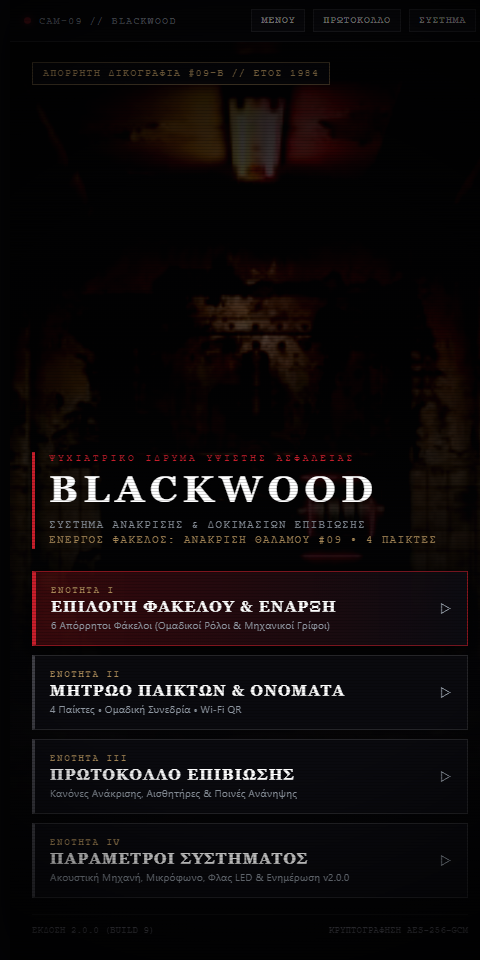
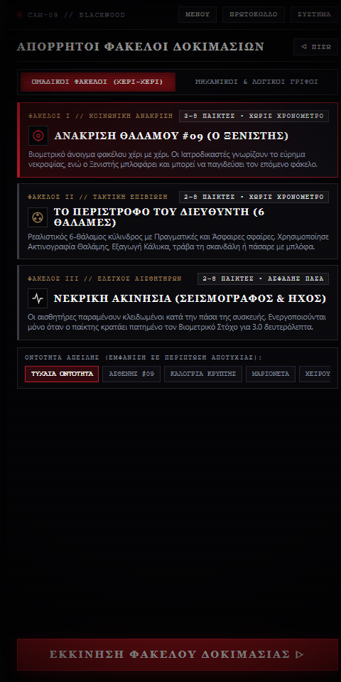
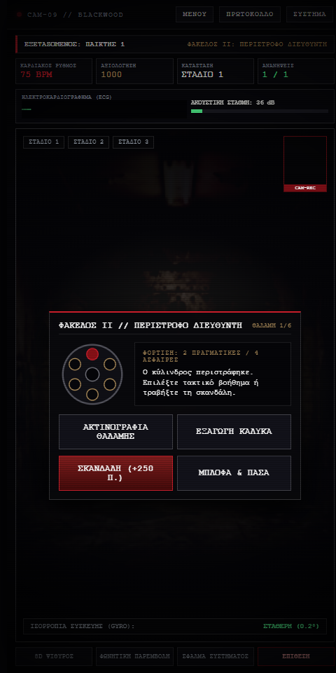
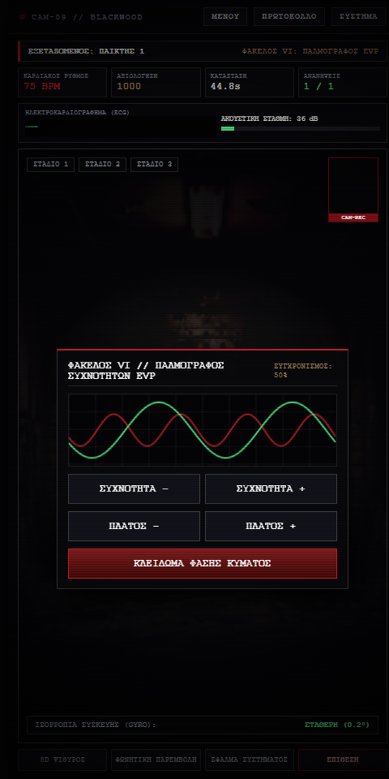
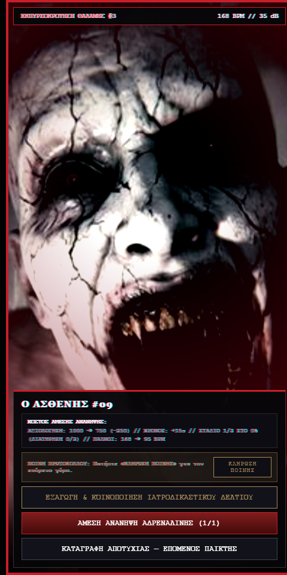
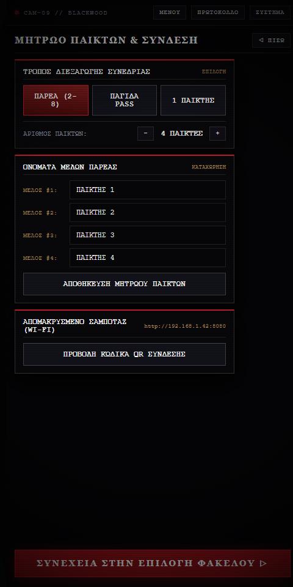

# BLACKWOOD — ΦΑΚΕΛΟΣ #09 (v2.0.0)
### *Σύστημα Ανάκρισης, Τακτικής Επιβίωσης & Μηχανικών Δοκιμασιών Τρόμου για Android*
**1–8 Παίκτες • Ελληνική Γλώσσα • Portrait 9:16 • Κρυπτογράφηση AES-256-GCM**

 

> 🔒 **[ΚΑΤΕΒΑΣΤΕ ΤΟ ΕΠΙΣΗΜΟ APK ΑΠΕΥΘΕΙΑΣ ΕΔΩ (v2.0.0 Build 9)](https://github.com/jemangr/pass-n-play-terror-releases/releases/latest/download/pass-n-play-terror.apk)**
>
> 🔗 **Μόνιμος Σύνδεσμος Λήψης:** `https://jemangr.app/terror/` → `https://github.com/jemangr/pass-n-play-terror-releases/releases/latest/download/pass-n-play-terror.apk`

---

## ΦΩΤΟΓΡΑΦΙΚΗ ΤΕΚΜΗΡΙΩΣΗ ΣΥΣΤΗΜΑΤΟΣ (SCREENSHOTS)

| ΚΕΝΤΡΙΚΟ ΜΕΝΟΥ ΔΙΚΟΓΡΑΦΙΑΣ | ΑΠΟΡΡΗΤΟΙ ΦΑΚΕΛΟΙ ΔΟΚΙΜΑΣΙΩΝ |
| :---: | :---: |
|  |  |

| ΠΕΡΙΣΤΡΟΦΟ ΔΙΕΥΘΥΝΤΗ (6 ΘΑΛΑΜΕΣ) | ΠΑΛΜΟΓΡΑΦΟΣ ΣΥΧΝΟΤΗΤΩΝ EVP |
| :---: | :---: |
|  |  |

| ΕΜΦΑΝΙΣΗ ΟΝΤΟΤΗΤΑΣ & ΙΑΤΡΟΔΙΚΑΣΤΙΚΟ ΔΕΛΤΙΟ | ΜΗΤΡΩΟ ΠΑΙΚΤΩΝ & ΣΥΝΔΕΣΗ WI-FI |
| :---: | :---: |
|  |  |

---

## ΑΝΑΒΑΘΜΙΣΕΙΣ ΕΚΔΟΣΗΣ 2.0.0 (BUILD 9)

Η έκδοση 2.0.0 αποτελεί πλήρη ανασχεδιασμό του συστήματος, μετατρέποντάς το από απλή εφαρμογή σε ένα σκοτεινό, ρεαλιστικό ψυχολογικό θρίλερ με κλινική και βιομηχανική αισθητική:

### 1. Αρχιτεκτονική Πλοήγησης & Καθαρό Περιβάλλον Χρήστη
- **Κατάργηση περιττών στοιχείων και emoji:** Πλήρης εξάλειψη παιδικών εικονιδίων και χρωματικών αντιθέσεων.
- **5 Αυτόνομες Οθόνες:**
  - `ΕΝΟΤΗΤΑ I: ΕΠΙΛΟΓΗ ΦΑΚΕΛΟΥ & ΕΝΑΡΞΗ` (Αρχειοθήκη 6 υποθέσεων σε 2 καρτέλες).
  - `ΕΝΟΤΗΤΑ II: ΜΗΤΡΩΟ ΠΑΙΚΤΩΝ & ΟΝΟΜΑΤΑ` (Καταχώρηση 1 έως 8 παικτών, τρόπος συνεδρίας, κωδικός QR τοπικού δικτύου).
  - `ΕΝΟΤΗΤΑ III: ΠΡΩΤΟΚΟΛΛΟ ΕΠΙΒΙΩΣΗΣ` (Αναλυτικοί κανόνες ανάκρισης και ποινών).
  - `ΕΝΟΤΗΤΑ IV: ΠΑΡΑΜΕΤΡΟΙ ΣΥΣΤΗΜΑΤΟΣ` (Ρυθμίσεις ακουστικής μηχανής, αισθητήρων και έλεγχος ενημερώσεων v2.0.0).
  - `ΕΝΟΤΗΤΑ V: ΘΑΛΑΜΟΣ ΔΟΚΙΜΑΣΙΑΣ` (Τηλεμετρία ΗΚΓ, ακουστική στάθμη dB, γυροσκόπιο και κάμερα αντίδρασης PiP).

### 2. Οι 6 Απόρρητοι Φάκελοι Δοκιμασιών
- **Ομαδικοί Φάκελοι (Χέρι-με-Χέρι • Χωρίς Αντίστροφο Χρονόμετρο κατά την Πάσα):**
  - **ΦΑΚΕΛΟΣ I: ΑΝΑΚΡΙΣΗ ΘΑΛΑΜΟΥ #09 (Ο ΞΕΝΙΣΤΗΣ):** Κοινωνική ανάκριση και ιατροδικαστική εξέταση. Οι Ιατροδικαστές γνωρίζουν το εύρημα νεκροψίας, ενώ ο Ξενιστής μπλοφάρει και έχει τη δυνατότητα να παγιδεύσει κρυφά τον επόμενο φάκελο.
  - **ΦΑΚΕΛΟΣ II: ΤΟ ΠΕΡΙΣΤΡΟΦΟ ΤΟΥ ΔΙΕΥΘΥΝΤΗ (6 ΘΑΛΑΜΕΣ):** Τακτική ρωσική ρουλέτα τύπου *Buckshot Roulette*. Πραγματικές και άσφαιρες σφαίρες, Ακτινογραφία Θαλάμης, Εξαγωγή Κάλυκα, εκπυρσοκρότηση στον εαυτό σου για πόντους ή πάσα με μπλόφα.
  - **ΦΑΚΕΛΟΣ III: ΝΕΚΡΙΚΗ ΑΚΙΝΗΣΙΑ (ΣΕΙΣΜΟΓΡΑΦΟΣ & ΗΧΟΣ):** Ασφαλής πάσα της συσκευής χωρίς ενεργούς αισθητήρες. Οι αισθητήρες ενεργοποιούνται αποκλειστικά όταν ο παίκτης κρατάει πατημένο τον Βιομετρικό Στόχο για 3.0 δευτερόλεπτα.
- **Μηχανικοί & Λογικοί Γρίφοι (Και Τριπλό Πρωτόκολλο Gauntlet):**
  - **ΦΑΚΕΛΟΣ IV: ΚΡΥΠΤΟΓΡΑΦΟΣ ΑΠΟΜΟΝΩΣΗΣ:** Μηχανικός περιστρεφόμενος δίσκος με ταχύτητα συνδεδεμένη με τους παλμούς σου (BPM).
  - **ΦΑΚΕΛΟΣ V: ΠΙΝΑΚΑΣ ΥΨΗΛΗΣ ΤΑΣΗΣ ΝΕΚΡΟΤΟΜΕΙΟΥ:** Λογικός γρίφος κυκλώματος (400V, GND, 240V CAP, 110V AUX, 600V ISO, 12V MED) με τρεις διαγνωστικούς κανόνες αποσύνδεσης φορτίου.
  - **ΦΑΚΕΛΟΣ VI: ΠΑΛΜΟΓΡΑΦΟΣ ΣΥΧΝΟΤΗΤΩΝ EVP:** Διπλός παλμογράφος σε πραγματικό Canvas για συντονισμό Συχνότητας (Hz) και Πλάτους (Amplitude) με το κυματικό ίχνος της οντότητας.

### 3. Ρεαλιστική Ακουστική Μηχανή Τρόμου (Acoustic Horror Engine)
- Κατάργηση συνθετικών απλών κυματομορφών.
- **Μοντελοποίηση Ανθρώπινων Φωνητικών Χορδών:** Παραγωγή κραυγής μέσω Glottal Impulse Train + στροβιλώδους θορύβου εισπνοής που διέρχεται από 3 παράλληλα φίλτρα Formant ανθρώπινου λάρυγγα (`F1=820Hz`, `F2=1980Hz`, `F3=3150Hz`).
- **Ασύμμετρη Παραμόρφωση Λυχνίας (Tube Saturation):** Πλήρης ενέργεια κορεσμού σήματος.
- **Στερεοφωνικό Reverb Σκοτεινού Διαδρόμου (`ConvolverNode`):** Αντανακλάσεις τσιμεντένιου θαλάμου ψυχιατρείου.
- **Υποηχητικό Χτύπημα Στήθους (32Hz Sub-Bass Slam)** κατά την εκδήλωση της επίθεσης.
- **Συνεχής Βιομηχανικός Βόμβος (46Hz & 68.5Hz Transformer Drone)** στον θάλαμο δοκιμασιών.

### 4. Εγγενής Ενσωμάτωση Android
- **Αυτόματη απαίτηση δικαιωμάτων:** Android Runtime Permissions για μικρόφωνο και κάμερα κατά την εκκίνηση.
- **Πραγματική μέτρηση στάθμης ήχου:** `AudioRecord` στα 16kHz PCM για ακριβή ανάγνωση dB φωνής.
- **Εγγενές Android Share Sheet:** Αποθήκευση του Ιατροδικαστικού Δελτίου στο `MediaStore` και αποστολή μέσω `Intent.ACTION_SEND`.
- **Φλας LED Κάμερας:** Παλμικός φωτισμός strobe μέσω `CameraManager.setTorchMode`.
- **Αυτόματες ενημερώσεις APK:** Έλεγχος νέων εκδόσεων και άμεση λήψη από το μενού ρυθμίσεων.

---

## ΤΕΧΝΙΚΗ ΤΕΚΜΗΡΙΩΣΗ (ΙΔΙΩΤΙΚΟ ΑΠΟΘΕΤΗΡΙΟ)

- [`DECISIONS.md`](./DECISIONS.md) — Αποφάσεις αρχιτεκτονικής λογισμικού (`ADR-001` έως `ADR-016`).
- [`Pass and Play Terror.docx`](./Pass%20and%20Play%20Terror.docx) — Αρχικό έγγραφο σχεδιασμού.
- [`walkthrough.md`](./walkthrough.md) — Οδηγός δοκιμών και επαλήθευσης.

---

**Copyright © 2026 jemangr. Όλα τα δικαιώματα διατηρούνται.**
