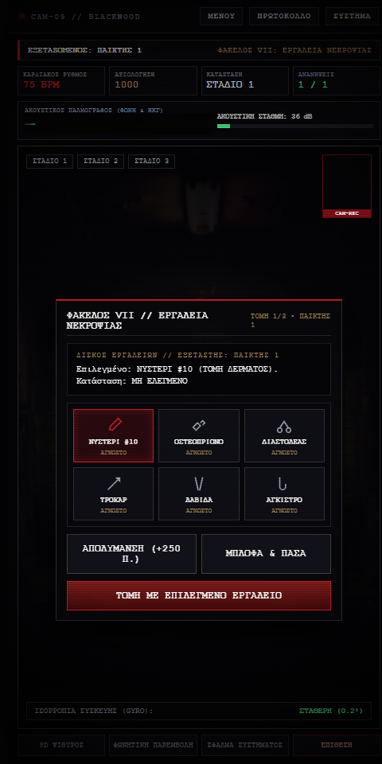
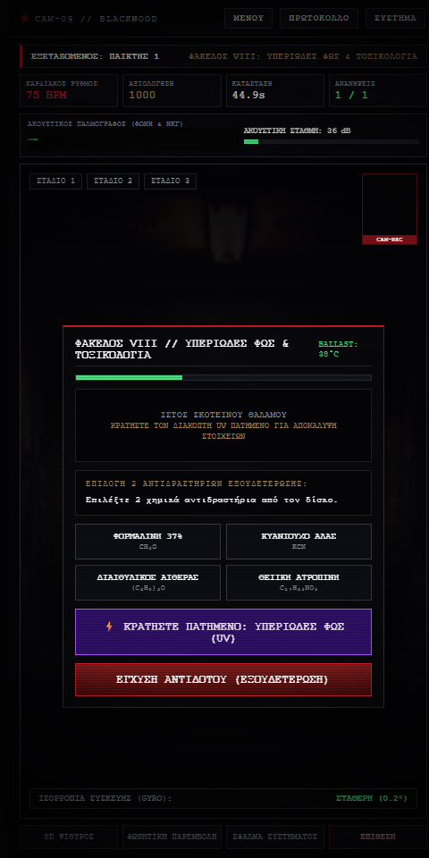
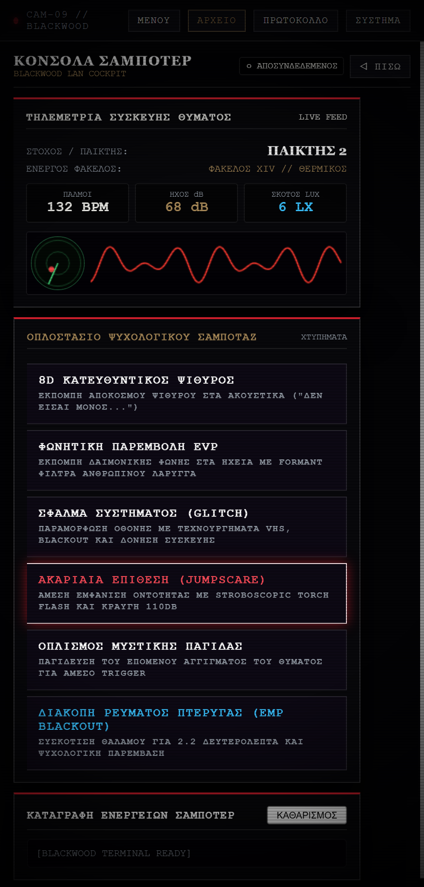

# BLACKWOOD — ΦΑΚΕΛΟΣ #09 (v2.2.0)
### *Σύστημα Ανάκρισης, Τακτικής Επιβίωσης & Μηχανικών Δοκιμασιών Τρόμου για Android*
**1–8 Παίκτες • Ελληνική Γλώσσα • Portrait 9:16 • Κρυπτογράφηση AES-256-GCM**

 

> 🔒 **[ΚΑΤΕΒΑΣΤΕ ΤΟ ΕΠΙΣΗΜΟ APK ΑΠΕΥΘΕΙΑΣ ΕΔΩ (v2.2.0 Build 11)](https://github.com/jemangr/pass-n-play-terror-releases/releases/latest/download/pass-n-play-terror.apk)**
>
> 🔗 **Μόνιμος Σύνδεσμος Λήψης:** `https://jemangr.app/terror/` → `https://github.com/jemangr/pass-n-play-terror-releases/releases/latest/download/pass-n-play-terror.apk`

---

## ΦΩΤΟΓΡΑΦΙΚΗ ΤΕΚΜΗΡΙΩΣΗ ΣΥΣΤΗΜΑΤΟΣ (SCREENSHOTS)

| ΚΕΝΤΡΙΚΟ ΜΕΝΟΥ ΔΙΚΟΓΡΑΦΙΑΣ | ΑΠΟΡΡΗΤΟΙ ΦΑΚΕΛΟΙ ΔΟΚΙΜΑΣΙΩΝ |
| :---: | :---: |
|  |  |

| ΠΕΡΙΣΤΡΟΦΟ ΔΙΕΥΘΥΝΤΗ (6 ΘΑΛΑΜΕΣ) | ΠΑΛΜΟΓΡΑΦΟΣ ΣΥΧΝΟΤΗΤΩΝ EVP |
| :---: | :---: |
|  |  |

| ΦΑΚΕΛΟΣ VII: ΕΡΓΑΛΕΙΑ ΝΕΚΡΟΨΙΑΣ | ΦΑΚΕΛΟΣ VIII: ΥΠΕΡΙΩΔΕΣ ΦΩΣ & ΤΟΞΙΚΟΛΟΓΙΑ |
| :---: | :---: |
|  |  |

| ΕΜΦΑΝΙΣΗ ΟΝΤΟΤΗΤΑΣ & ΙΑΤΡΟΔΙΚΑΣΤΙΚΟ ΔΕΛΤΙΟ | ΜΗΤΡΩΟ ΠΑΙΚΤΩΝ & ΣΥΝΔΕΣΗ WI-FI |
| :---: | :---: |
|  |  |

| ΑΠΟΜΑΚΡΥΣΜΕΝΗ ΚΟΝΣΟΛΑ ΣΑΜΠΟΤΕΡ (PC/LAN) |
| :---: |
|  |

---

## ΑΝΑΒΑΘΜΙΣΕΙΣ ΕΚΔΟΣΗΣ 2.2.0 (BUILD 11) — ΑΠΟΜΟΝΩΣΗ ΗΧΟΥ & AUDIO FOCUS

Η έκδοση 2.2.0 επιλύει ριζικά το ζήτημα της ηχητικής απομόνωσης κατά την εναλλαγή οθονών και τις τηλεφωνικές κλήσεις:

### 1. Διαχείριση Android Audio Focus (`AudioManager`)
- **Αυτόματη Σίγαση σε Εισερχόμενη Κλήση:** Όταν χτυπήσει το τηλέφωνο ή ενεργοποιηθεί εισερχόμενη κλήση/κουδούνισμα, το σύστημα λαμβάνει αυτόματα `AUDIOFOCUS_LOSS_TRANSIENT`. Όλοι οι ήχοι του παιχνιδιού τίθενται ακαριαία σε απόλυτη σίγαση (`gain = 0.0`) και το WebAudio `AudioContext` αναστέλλεται (`suspend()`).
- **Απελευθέρωση Hardware Μικροφώνου:** Στο `onPause()` και `onStop()`, το native thread του `AudioRecord` σταματά και αποδεσμεύει αμέσως το μικρόφωνο ώστε να μην παρεμποδίζει την τηλεφωνική συνομιλία.
- **Επαναφορά με Focus:** Μόλις ολοκληρωθεί η κλήση και η εφαρμογή επανέλθει στο προσκήνιο (`AUDIOFOCUS_GAIN`), ο ήχος αποκαθίσταται ομαλά μόνο εάν ο παίκτης βρίσκεται σε ενεργή δοκιμασία.

### 2. Ηχητική Απομόνωση κατά την Αλλαγή Οθόνης (Screen Navigation)
- **Πλήρης Σίγαση στα Μενού:** Όταν ο παίκτης πατά «◁ ΠΙΣΩ», «ΜΕΝΟΥ» ή αλλάζει οθόνη (Φάκελοι, Μητρώο, Ρυθμίσεις, Σαμποτέρ), διακόπτονται αμέσως όλοι οι ήχοι περιβάλλοντος (ambient room drone, UV ballast hum, text-to-speech) και το `masterAudioBus` τίθεται στο 0.
- **Web Visibility & Lifecycle Listeners:** Υποστήριξη `visibilitychange`, `pagehide`, `pageshow`, `blur` και `focus` ώστε οποιαδήποτε ελαχιστοποίηση της εφαρμογής ή άνοιγμα της μπάρας ειδοποιήσεων να διακόπτει αμέσως τον ήχο.

---

## ΑΝΑΒΑΘΜΙΣΕΙΣ ΕΚΔΟΣΗΣ 2.1.0 (BUILD 10)

Η έκδοση 2.1.0 ολοκληρώνει το όραμα του ψυχολογικού και ιατροδικαστικού τρόμου, προσθέτοντας 2 νέους απόρρητους φακέλους νεκροτομείου και εξελιγμένους αισθητήρες ακρόασης:

### 1. Νέοι Απόρρητοι Φάκελοι Νεκροτομείου
- **ΦΑΚΕΛΟΣ VII: ΤΟ ΜΟΛΥΣΜΕΝΟ ΕΡΓΑΛΕΙΟ ΝΕΚΡΟΨΙΑΣ (`autopsy`):** 6 ανατομικά χειρουργικά εργαλεία στον ανοξείδωτο δίσκο νεκροτομείου (Νυστέρι #10, Οστεοπρίονο, Διαστολέας Θώρακα, Τροκάρ Νεκροψίας, Ανατομική Λαβίδα, Άγκιστρο Ιστών). 1–2 εργαλεία φέρουν θανατηφόρο βιολογικό παθογόνο. Οι παίκτες μπορούν να απολυμάνουν με οινόπνευμα (+250 π.), να εκτελέσουν τομή (+200 π.) ή να πασάρουν με μπλόφα στον επόμενο.
- **ΦΑΚΕΛΟΣ VIII: ΥΠΕΡΙΩΔΕΣ ΦΩΣ & ΤΟΞΙΚΟΛΟΓΙΑ (`toxicology`):** Σκοτεινός θάλαμος νεκροτομείου. Κρατώντας πατημένο τον διακόπτη υπεριώδους φωτός (UV), αποκαλύπτονται τα φωσφορίζοντα ίχνη και η φόρμουλα εξουδετέρωσης στον ιστό πριν εκραγεί το ballast (105°C). Συνδυασμός των 2 σωστών χημικών αντιδραστηρίων (Φορμαλίνη, Κυανιούχο Άλας, Αιθέρας, Ατροπίνη).

### 2. Ψυχοακουστικό Φίλτρο Πανικού & Ακουστικό Τούνελ (Panic Audio Tunneling)
- **Ακουστική Απομόνωση Υπερταχυκαρδίας:** Σε κατάσταση οξέος φόβου όταν οι σφυγμοί ξεπερνούν τους 110 BPM, το σύστημα ενεργοποιεί δυναμικό φίλτρο `BiquadFilterNode` (`lowpass` στα 360Hz με συντονισμένο peak `Q=3.2`). Όλοι οι περιφερειακοί ήχοι πνίγονται σε έναν υπόκωφο βόμβο, ενώ ο καρδιακός παλμός (thump) παραμένει δυνατός και διαπεραστικός. Όταν οι παλμοί πέσουν κάτω από τους 95 BPM, η ακοή αποκαθίσταται πλήρως στα 20kHz.

### 3. Αισθητήρας Ψιθύρων & Βαριάς Αναπνοής (>48 dB)
- **Εντοπισμός Αναπνοής & Ψιθύρου:** Στο Φάκελο III (Νεκρική Ακινησία) και στο Φάκελο VIII (Τοξικολογία), το μικρόφωνο ανιχνεύει ακόμη και χαμηλόφωνους ψιθύρους ή βαριά ανάσα (>48 dB), εμφανίζοντας κίτρινη παλλόμενη προειδοποίηση και επιταχύνοντας την άνοδο θερμοκρασίας και την επιθετικότητα της οντότητας.

### 4. Εμπλουτισμένο Ιατροδικαστικό Δελτίο Νεκροψίας
- Έκδοση πιστοποιητικού με μοναδικό σειριακό αριθμό νεκροψίας (`BW-XXXXXX`), ακριβή ημερομηνία/ώρα ISO, κόκκινη κλινική σφραγίδα οξείας ανακοπής, μέγιστους καταγεγραμμένους παλμούς (Peak BPM) και ένταση κραυγής (Peak Scream dB), συνοδευόμενα από τη φωτογραφία αντίδρασης της εμπρόσθιας κάμερας.

---

## ΑΝΑΒΑΘΜΙΣΕΙΣ ΕΚΔΟΣΗΣ 2.0.0 (BUILD 9)

Η έκδοση 2.0.0 αποτελεί πλήρη ανασχεδιασμό του συστήματος, μετατρέποντάς το από απλή εφαρμογή σε ένα σκοτεινό, ρεαλιστικό ψυχολογικό θρίλερ με κλινική και βιομηχανική αισθητική:

### 1. Αρχιτεκτονική Πλοήγησης & Καθαρό Περιβάλλον Χρήστη
- **Κατάργηση περιττών στοιχείων και emoji:** Πλήρης εξάλειψη παιδικών εικονιδίων και χρωματικών αντιθέσεων.
- **5 Αυτόνομες Οθόνες:**
  - `ΕΝΟΤΗΤΑ I: ΕΠΙΛΟΓΗ ΦΑΚΕΛΟΥ & ΕΝΑΡΞΗ` (Αρχειοθήκη 6 υποθέσεων σε 2 καρτέλες).
  - `ΕΝΟΤΗΤΑ II: ΜΗΤΡΩΟ ΠΑΙΚΤΩΝ & ΟΝΟΜΑΤΑ` (Καταχώρηση 1 έως 8 παικτών, τρόπος συνεδρίας, κωδικός QR τοπικού δικτύου).
  - `ΕΝΟΤΗΤΑ III: ΠΡΩΤΟΚΟΛΛΟ ΕΠΙΒΙΩΣΗΣ` (Αναλυτικοί κανόνες ανάκρισης και ποινών).
  - `ΕΝΟΤΗΤΑ IV: ΠΑΡΑΜΕΤΡΟΙ ΣΥΣΤΗΜΑΤΟΣ` (Ρυθμίσεις ακουστικής μηχανής, αισθητήρων και έλεγχος ενημερώσεων v2.0.0).
  - `ΕΝΟΤΗΤΑ V: ΘΑΛΑΜΟΣ ΔΟΚΙΜΑΣΙΑΣ` (Τηλεμετρία ΗΚΓ, ακουστική στάθμη dB, γυροσκόπιο και κάμερα αντίδρασης PiP).

### 2. Οι 6 Απόρρητοι Φάκελοι Δοκιμασιών
- **Ομαδικοί Φάκελοι (Χέρι-με-Χέρι • Χωρίς Αντίστροφο Χρονόμετρο κατά την Πάσα):**
  - **ΦΑΚΕΛΟΣ I: ΑΝΑΚΡΙΣΗ ΘΑΛΑΜΟΥ #09 (Ο ΞΕΝΙΣΤΗΣ):** Κοινωνική ανάκριση και ιατροδικαστική εξέταση. Οι Ιατροδικαστές γνωρίζουν το εύρημα νεκροψίας, ενώ ο Ξενιστής μπλοφάρει και έχει τη δυνατότητα να παγιδεύσει κρυφά τον επόμενο φάκελο.
  - **ΦΑΚΕΛΟΣ II: ΤΟ ΠΕΡΙΣΤΡΟΦΟ ΤΟΥ ΔΙΕΥΘΥΝΤΗ (6 ΘΑΛΑΜΕΣ):** Τακτική ρωσική ρουλέτα τύπου *Buckshot Roulette*. Πραγματικές και άσφαιρες σφαίρες, Ακτινογραφία Θαλάμης, Εξαγωγή Κάλυκα, εκπυρσοκρότηση στον εαυτό σου για πόντους ή πάσα με μπλόφα.
  - **ΦΑΚΕΛΟΣ III: ΝΕΚΡΙΚΗ ΑΚΙΝΗΣΙΑ (ΣΕΙΣΜΟΓΡΑΦΟΣ & ΗΧΟΣ):** Ασφαλής πάσα της συσκευής χωρίς ενεργούς αισθητήρες. Οι αισθητήρες ενεργοποιούνται αποκλειστικά όταν ο παίκτης κρατάει πατημένο τον Βιομετρικό Στόχο για 3.0 δευτερόλεπτα.
- **Μηχανικοί & Λογικοί Γρίφοι (Και Τριπλό Πρωτόκολλο Gauntlet):**
  - **ΦΑΚΕΛΟΣ IV: ΚΡΥΠΤΟΓΡΑΦΟΣ ΑΠΟΜΟΝΩΣΗΣ:** Μηχανικός περιστρεφόμενος δίσκος με ταχύτητα συνδεδεμένη με τους παλμούς σου (BPM).
  - **ΦΑΚΕΛΟΣ V: ΠΙΝΑΚΑΣ ΥΨΗΛΗΣ ΤΑΣΗΣ ΝΕΚΡΟΤΟΜΕΙΟΥ:** Λογικός γρίφος κυκλώματος (400V, GND, 240V CAP, 110V AUX, 600V ISO, 12V MED) με τρεις διαγνωστικούς κανόνες αποσύνδεσης φορτίου.
  - **ΦΑΚΕΛΟΣ VI: ΠΑΛΜΟΓΡΑΦΟΣ ΣΥΧΝΟΤΗΤΩΝ EVP:** Διπλός παλμογράφος σε πραγματικό Canvas για συντονισμό Συχνότητας (Hz) και Πλάτους (Amplitude) με το κυματικό ίχνος της οντότητας.

### 3. Ρεαλιστική Ακουστική Μηχανή Τρόμου (Acoustic Horror Engine)
- Κατάργηση συνθετικών απλών κυματομορφών.
- **Μοντελοποίηση Ανθρώπινων Φωνητικών Χορδών:** Παραγωγή κραυγής μέσω Glottal Impulse Train + στροβιλώδους θορύβου εισπνοής που διέρχεται από 3 παράλληλα φίλτρα Formant ανθρώπινου λάρυγγα (`F1=820Hz`, `F2=1980Hz`, `F3=3150Hz`).
- **Ασύμμετρη Παραμόρφωση Λυχνίας (Tube Saturation):** Πλήρης ενέργεια κορεσμού σήματος.
- **Στερεοφωνικό Reverb Σκοτεινού Διαδρόμου (`ConvolverNode`):** Αντανακλάσεις τσιμεντένιου θαλάμου ψυχιατρείου.
- **Υποηχητικό Χτύπημα Στήθους (32Hz Sub-Bass Slam)** κατά την εκδήλωση της επίθεσης.
- **Συνεχής Βιομηχανικός Βόμβος (46Hz & 68.5Hz Transformer Drone)** στον θάλαμο δοκιμασιών.

### 4. Εγγενής Ενσωμάτωση Android
- **Αυτόματη απαίτηση δικαιωμάτων:** Android Runtime Permissions για μικρόφωνο και κάμερα κατά την εκκίνηση με αναλυτικό εισαγωγικό οδηγό (Walkthrough Modal).
- **Πραγματική μέτρηση στάθμης ήχου & Ακουστικός Παλμογράφος:** `AudioRecord` στα 16kHz PCM για δυναμική κυματομορφή φωνής που αντιδρά σε ψιθύρους και κραυγές.
- **Εγγενής Χειρισμός Πλήκτρου Πίσω (Android Back Gesture):** Ασφαλής πλοήγηση χωρίς ακούσια έξοδο, με ασπίδα διπλού πατήματος (double-tap guard 2.0s) και ειδοποίηση Toast στην αρχική οθόνη.
- **Εγγενές Android Share Sheet:** Αποθήκευση του Ιατροδικαστικού Δελτίου στο `MediaStore` και αποστολή μέσω `Intent.ACTION_SEND`.
- **Φλας LED Κάμερας:** Παλμικός φωτισμός strobe μέσω `CameraManager.setTorchMode`.
- **Αυτόματες ενημερώσεις APK:** Έλεγχος νέων εκδόσεων και άμεση λήψη από το μενού ρυθμίσεων.

### 5. Απομακρυσμένο Σαμποτάζ (LAN Cockpit για PC & Δεύτερες Συσκευές)
- **Αυτόματη Ανίχνευση IP Wi-Fi:** Εξελιγμένος αλγόριθμος dual-pass στο `MainActivity.java` που διαβάζει το `WifiManager` και τις διεπαφές δικτύου (`wlan0`, `ap0`, `eth0`), φιλτράροντας τις διευθύνσεις κινητής τηλεφωνίας (CGNAT).
- **Πλήρες Τερματικό Σαμποτέρ (`#screen-saboteur`):** Όταν οποιοσδήποτε υπολογιστής ή κινητό στο ίδιο Wi-Fi ανοίξει το URL `http://<WIFI_IP>:8080/?role=saboteur` (ή σκανάρει το QR code), ανοίγει αυτόματα η σκοτεινή Κονσόλα Σαμποτέρ.
- **Ζωντανή Τηλεμετρία Θύματος (Live Telemetry Feed):** Ο Σαμποτέρ παρακολουθεί σε πραγματικό χρόνο ποιος παίκτης έχει τη συσκευή, ποιον φάκελο εκτελεί, τους καρδιακούς παλμούς (BPM), τα ντεσιμπέλ της φωνής (dB) και ζωντανό παλμογράφο.
- **Τακτικό Οπλοστάσιο Επιθέσεων (Dual-Channel WebSocket + REST API):**
  - **8D ΚΑΤΕΥΘΥΝΤΙΚΟΣ ΨΙΘΥΡΟΣ:** Αποστολή κατευθυντικού ψιθύρου στα ακουστικά του θύματος.
  - **ΦΩΝΗΤΙΚΗ ΠΑΡΕΜΒΟΛΗ EVP:** Εκπομπή δαιμονικής φωνής στα ηχεία με formant φίλτρα ανθρώπινου λάρυγγα.
  - **ΣΦΑΛΜΑ ΣΥΣΤΗΜΑΤΟΣ (GLITCH):** Παραμόρφωση οθόνης με τεχνουργήματα VHS, blackout και δόνηση.
  - **ΑΚΑΡΙΑΙΑ ΕΠΙΘΕΣΗ (JUMPSCARE):** Άμεση πυροδότηση οντότητας με stroboscopic torch flash και κραυγή 110dB.
  - **ΟΠΛΙΣΜΟΣ ΜΥΣΤΙΚΗΣ ΠΑΓΙΔΑΣ:** Παγίδευση του επόμενου αγγίγματος του θύματος για άμεση εξόντωση.

---

## ΤΕΧΝΙΚΗ ΤΕΚΜΗΡΙΩΣΗ (ΙΔΙΩΤΙΚΟ ΑΠΟΘΕΤΗΡΙΟ)

- [`DECISIONS.md`](./DECISIONS.md) — Αποφάσεις αρχιτεκτονικής λογισμικού (`ADR-001` έως `ADR-016`).
- [`Pass and Play Terror.docx`](./Pass%20and%20Play%20Terror.docx) — Αρχικό έγγραφο σχεδιασμού.
- [`walkthrough.md`](./walkthrough.md) — Οδηγός δοκιμών και επαλήθευσης.

---

**Copyright © 2026 jemangr. Όλα τα δικαιώματα διατηρούνται.**
