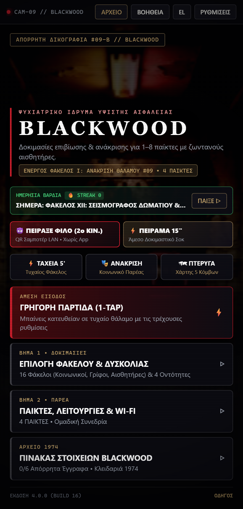
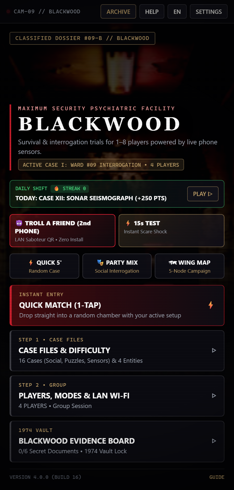
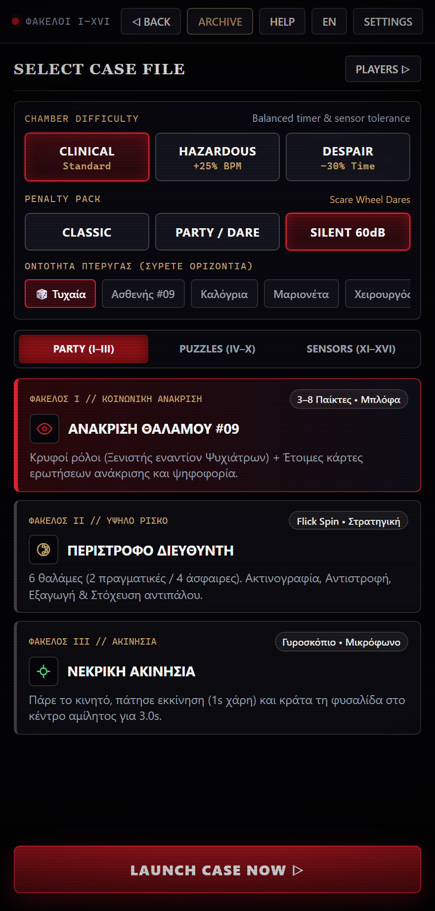
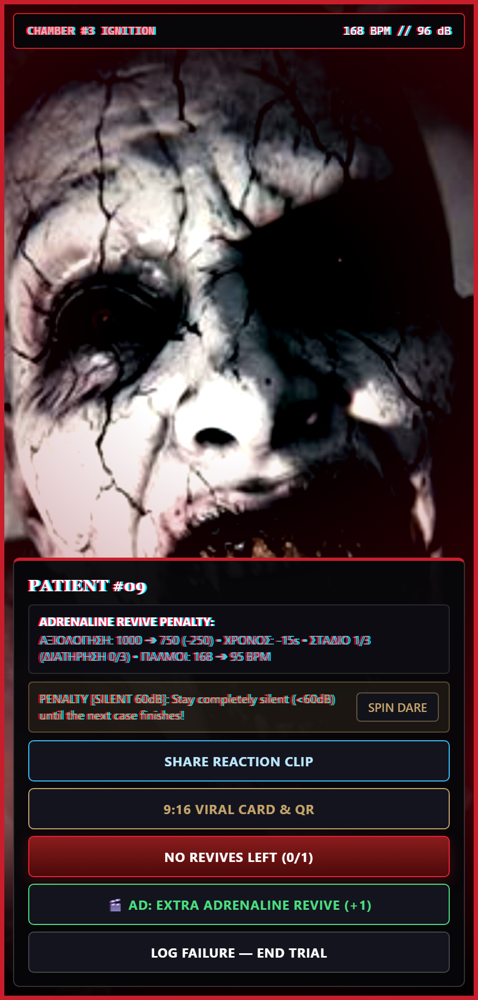
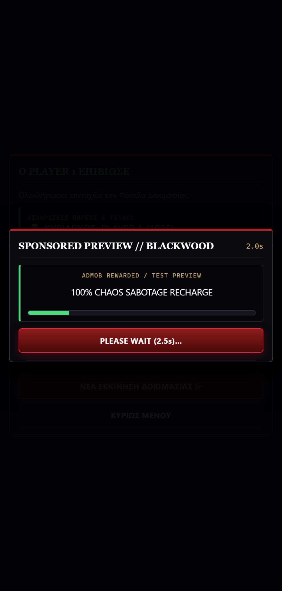
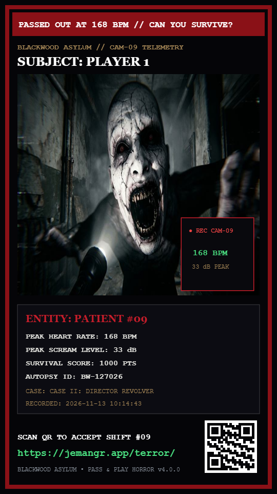
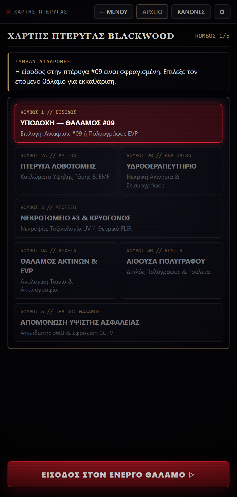
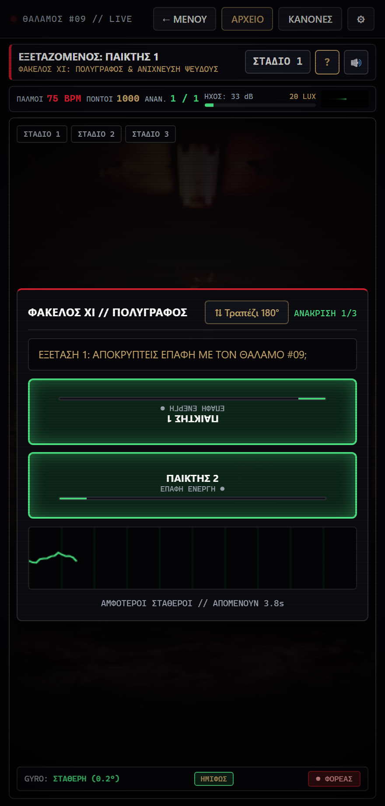

# BLACKWOOD — ΦΑΚΕΛΟΣ #09 (v4.0.0)
### *Bilingual (EN+EL) Tactical Survival & 16-Case Horror Game for Android • Pass & Play + LAN Saboteur*
**1–8 Παίκτες • Δίγλωσσο EN/EL • Ημερήσια Βάρδια & Streak • 3 Πακέτα Ποινών • Viral 9:16 Κάρτα & QR • 16 Δωρεάν Φάκελοι • AES-256-GCM**

 

> 🔒 **[ΚΑΤΕΒΑΣΤΕ ΤΟ ΕΠΙΣΗΜΟ APK ΑΠΕΥΘΕΙΑΣ ΕΔΩ (v4.0.0 Build 16)](https://github.com/jemangr/pass-n-play-terror-releases/releases/latest/download/pass-n-play-terror.apk)**
>
> 🔗 **Μόνιμος Σύνδεσμος Λήψης:** `https://jemangr.app/terror/` → `https://github.com/jemangr/pass-n-play-terror-releases/releases/latest/download/pass-n-play-terror.apk`

---

## ΦΩΤΟΓΡΑΦΙΚΗ ΤΕΚΜΗΡΙΩΣΗ ΣΥΣΤΗΜΑΤΟΣ (SCREENSHOTS v4.0.0)

| ΚΕΝΤΡΙΚΟ ΜΕΝΟΥ (EL) & ΗΜΕΡΗΣΙΑ ΒΑΡΔΙΑ | BILINGUAL MENU (EN) & HERO HOOKS |
| :---: | :---: |
|  |  |

| ΠΑΚΕΤΑ ΠΟΙΝΩΝ & ΦΑΚΕΛΟΙ (EN) | JUMPSCARE + AD REVIVE BRIDGE |
| :---: | :---: |
|  |  |

| SPONSORED AD TEST PREVIEW (2.5s) | 9:16 VIRAL REACTION CARD + QR |
| :---: | :---: |
|  |  |

| ΧΑΡΤΗΣ ΠΤΕΡΥΓΑΣ 5 ΚΟΜΒΩΝ | ΠΟΛΥΓΡΑΦΟΣ — ΤΡΑΠΕΖΙ 180° |
| :---: | :---: |
|  |  |

---

## ΑΝΑΒΑΘΜΙΣΕΙΣ ΕΚΔΟΣΗΣ 4.0.0 (BUILD 16) — COMMERCIAL FUNNEL, EN+EL & VIRAL SHARE

- **Πλήρης Δίγλωσση Υποστήριξη (`EN` + `EL`):** Αυτόματη ανίχνευση γλώσσας συσκευής (`EN` εκτός ελληνικών συσκευών) και 1-tap εναλλαγή από το Top Bar, μαζί με δαιμονικές φωνές TTS σε `en-US` & `el-GR`.
- **Zero Cold-Start Friction:** Αφαίρεση ψυχρού popup αδειών κατά το άνοιγμα — το μικρόφωνο ζητείται **Just-In-Time** στην έναρξη της δοκιμασίας και η Selfie Κάμερα Αντιδράσεων είναι προαιρετική από τις Ρυθμίσεις.
- **Hero Viral & 15" Hooks:** Προβολή **«Πείραξε Φίλο (2ο Κινητό LAN)»** με άμεσο QR και **«Πείραμα 15"»** για ακαριαίο δοκιμαστικό σοκ από την αρχική οθόνη.
- **Ημερήσια Βάρδια & Streak (`YYYY-MM-DD`):** Νέα ημερήσια υπόθεση με +250 πόντους μπόνους και σερί επιβίωσης (`🔥 STREAK`).
- **3 Πακέτα Ποινών Πάρτι:** Επιλογή ανάμεσα σε **Κλασικό**, **Party / Δώρα** και **Αφωνία <60dB** στον Τροχό Τρόμου.
- **9:16 Viral TikTok/Reels Compositor (`540x960`):** Κοινοποίηση κάρτας με τίτλο *"PASSED OUT AT 168 BPM // CAN YOU SURVIVE?"*, τηλεμετρία BPM/dB, Selfie PiP και ενσωματωμένο σκανάρισμα QR για `https://jemangr.app/terror/`.
- **Δωρεάν με Διαφημίσεις & AdMob Bridge:** Όλοι οι 16 Φάκελοι I–XVI είναι ελεύθεροι από την αρχή, με Rewarded Ad bridge (`2.5s` Test Preview) για Extra Ανάνηψη & 100% Ενέργεια Χάους.

---

## ΑΝΑΒΑΘΜΙΣΕΙΣ ΕΚΔΟΣΗΣ 3.0.0 (BUILD 15) — UI/UX OVERHAUL, ΧΑΡΤΗΣ ΠΤΕΡΥΓΑΣ 5 ΚΟΜΒΩΝ & GAMEPLAY I–XVI

- **Διπλή Τυπογραφία (`--font-sans` & `--font-mono`):** Καθαρές οδηγίες & περιγραφές, μονοδιάστατοι κωδικοί/χρονόμετρα και αποκατάσταση active states δυσκολίας (`.selected`).
- **3 Έτοιμες Προεπιλογές (Ταχεία 5', Ανάκρισις Πάρτι, Πτέρυγα), Onboarding 3 Βημάτων & Πλήκτρο Βοήθειας `?`:** Αυτόματη παύση χρόνου + θόλωμα αρένας και 3-γραμμο ευρετήριο Στόχου/Χειρισμού/Ποινής ανά φάκελο.
- **Διαδραστικός Χάρτης Πτέρυγας 5 Κόμβων (`#screen-map`):** Επιλογή διαδρομής (*Πτέρυγα Λοβοτομής vs Υδροθεραπευτήριο*, *Αρχεία vs Κρύπτη Πολυγράφου*) και συμβάντα διαδρόμου ανάμεσα στα στάδια.
- **Λειτουργία Τραπεζιού 180° (Dual-Player Table Mode):** Αντιστροφή του πάνω pad στον **Διπλό Πολύγραφο (XI)** και τον **Απινιδωτή R-Wave (XV)** για αντικριστό παιχνίδι στο τραπέζι.
- **Χειρισμός & Οπτικό Feedback Φακέλων I–XVI:** Touch Loupe στην Ακτινογραφία (`X`), Drag Scrub Rail στην Ταινία EVP (`IX`), Dual Sliders + μπάρα συγχρονισμού στον Παλμογράφο (`VI`), 5-LED μπάρα στο EMF (`XIII`), `-24px` Y-offset αφής στον Θερμικό FLIR (`XIV`), 4-Room Mini-Map στο CCTV (`XVI`), Χρόνος 1.0s προετοιμασίας στο Άγαλμα (`III`), Κάρτες Ερωτήσεων στον Θάλαμο #09 (`I`), Visual Bar Wires (`V`).
- **Κονσόλα Σαμποτέρ LAN & Party Awards:** Νέες ενέργειες αποπροσανατολισμού (**Ψευδής Παλμός 175 BPM** & **Αναστροφή Οθόνης 180°**) και βραβεία παρέας στο τέλος γύρου.

---

## ΑΝΑΒΑΘΜΙΣΕΙΣ ΕΚΔΟΣΗΣ 2.5.0 (BUILD 14) — ΒΑΘΙΑ ΔΙΟΡΘΩΣΗ ΡΟΗΣ, BUGFIXES & GAMEPLAY ΕΠΕΚΤΑΣΗ (I–XVI)

### 1. Κρίσιμες Διορθώσεις Bugs & Ροής
- **Ακτινογραφία (`xray`):** Διορθώθηκε η κάθετη γραμμή σταυρονήματος Q1–Q4, προστέθηκε ποινή +14 BPM/-5s σε λάθος σάρωση, φωσφορισμός ξένου σώματος μόνο στο sweet spot `35%–68%` Dimmer και έλεγχος τρόμου γυροσκοπίου (`>6.5°`).
- **Πολύγραφος (`polygraph`):** Αφαιρέθηκε το λανθασμένο αντίστροφο χρονόμετρο 45s, προστέθηκαν ανεξάρτητες μπάρες στρες ΠΑΙΚΤΗ Α & Β και αυτόματος εντοπισμός υπαίτιου κατάρρευσης.
- **Ομαδική Ροή & Σκορ:** Τα ομαδικά παιχνίδια (`possessed`, `roulette`, `statue`, `autopsy`, `polygraph`) ολοκληρώνονται πλέον σε 1 συμπαγή παρτίδα ομάδας με **συσσωρευτική βαθμολογία** μεταξύ γύρων, ενώ οι κρυφές παγίδες Pass-and-Play πυροδοτούνται σε όλα τα στάδια.
- **Επιλογή Κατηγορίας Tabs & Stealth Σαμποτάζ:** Η αλλαγή καρτέλας δεν ακυρώνει τον επιλεγμένο φάκελο, η μπάρα δοκιμαστικού σαμποτάζ κρύφτηκε από την οθόνη θύματος (ρυθμιζόμενη στα Options), και ο Προδότης ενεργοποιείται διακριτικά με διπλό πάτημα στον τίτλο.

### 2. Δυσκολία, Γρήγορη Εκκίνηση, Solo AI, Persistence & Vault 1974
- **3 Επίπεδα Δυσκολίας (`clinical` / `hard` / `despair`)**, κουμπί **ΓΡΗΓΟΡΗ ΕΚΚΙΝΗΣΗ**, κλιμάκωση Εκστρατείας, **0.28s Audio Vacuum** πριν το jumpscare & **Live Calibration Telemetry**.
- **AI Μάρτυρες σε Solo Φάκελο I (`possessed`):** 3 διασταυρωμένες μαρτυρίες όπου 1 αντιφάσκει με το ιατροδικαστικό εύρημα.
- **Μόνιμο Αρχείο `localStorage` & Κλειδαριά Θησαυροφυλακίου 1974:** Διατήρηση εγγράφων/στοιχείων/ρεκόρ και μυστική απασφάλιση κωδικού Blackwood.

### 3. Ενισχυμένο Gameplay II–XVI & Voltage Economy Σαμποτέρ
- **Cases II–XVI:** *Invert Polarity* & *Shoot Opponent* στη Ρουλέτα, κωδικός 4 ψηφίων Cryptex (`1974`), υποχρεωτική ζώνη AM/FM/SW στον Παλμογράφο, όριο 2 απολυμάνσεων στη Νεκροψία, 6 αντιδραστήρια με ακριβή σειρά στην Τοξικολογία, χειροκίνητο scrub μπομπίνας & θραύση 15 ips, ηχητικός εντοπισμός & blind-zone Σεισμογράφου, ψευδής εστία 50Hz στο EMF, κινούμενο θερμό δόλωμα `+37.2°C` στο FLIR, και υπερφόρτιση >360J + κλιμάκωση R-wave με βάση το BPM.
- **Σαμποτέρ LAN Voltage Economy (0–100%, +4%/s) & Host Live Counter Badge.**

---

## ΑΝΑΒΑΘΜΙΣΕΙΣ ΕΚΔΟΣΗΣ 2.4.0 (BUILD 13) — ΠΛΗΡΗΣ ΕΠΕΚΤΑΣΗ ΠΛΟΚΗΣ 1974, 6 ΝΕΟΙ ΦΑΚΕΛΟΙ ΑΙΣΘΗΤΗΡΩΝ & ΚΟΝΣΟΛΑ ΣΑΜΠΟΤΕΡ

### 1. 6 Νέα Αισθητηριακά Παιχνίδια (Φάκελοι XI–XVI)
- **ΦΑΚΕΛΟΣ XI (`polygraph`):** Διπλός βιομετρικός πολύγραφος 2 παικτών με ταυτόχρονη επαφή ηλεκτροδίων και έλεγχο μικρο-τρόμου/θόρυβου.
- **ΦΑΚΕΛΟΣ XII (`seismograph`):** Σεισμογράφος θαλάμου & ακουστικό σόναρ με native ανίχνευση κρούσης/χτυπήματος επιφάνειας.
- **ΦΑΚΕΛΟΣ XIII (`emf_radar`):** Ανιχνευτής ηλεκτρομαγνητικών πεδίων EMF 360° μέσω `Sensor.TYPE_MAGNETIC_FIELD` (ή manual sweep).
- **ΦΑΚΕΛΟΣ XIV (`thermal`):** Θερμικός σαρωτής FLIR νυχτερινής επιτήρησης για εντοπισμό ψυχρών ιχνών (-14°C).
- **ΦΑΚΕΛΟΣ XV (`defibrillator`):** Διπλός απινιδωτής 360 Joules συγχρονισμένος με την κορυφή R του ΗΚΓ.
- **ΦΑΚΕΛΟΣ XVI (`cctv_lockdown`):** Νυχτερινή βάρδια 4 καμερών ασφαλείας, στερεοφωνικά βήματα προειδοποίησης και μαγνητική σφράγιση θυρών.

### 2. Οπτικό Σύστημα Τρόμου, Αφήγηση 1974 & Nightmare Permadeath
- **Δυναμικά Φόντα 3 Νέων Πτερύγων:** Διαφορετικό περιβάλλον για Νεκροτομείο, Πτέρυγα Λοβοτομής και Υδροθεραπευτήριο, συνδυασμένο με **2.5D Parallax** κίνησης φακού.
- **Αιματηρά Τριχοειδή, Subliminals 60ms & Παραισθήσεις:** Κόκκινο περιμετρικό αγγειακό δίκτυο κλιμακούμενο πάνω από 95 BPM, υποσυνείδητα καρέ και στοχευμένες φράσεις με το όνομα του παίκτη.
- **Evidence Board 1974, Πρωτόκολλο Εφιάλτη & Επίλογοι:** Πίνακας ξεκλειδωμένων τεκμηρίων (`doc1`–`doc6`), λειτουργία Permadeath χωρίς δεύτερη ευκαιρία στον γύρο και 3 διακλαδούμενοι επίλογοι (Αθώωση, Διαρροή Απομόνωσης, Κατάληψη).

### 3. Αναβαθμίσεις Υπαρχόντων Φακέλων (I–X), Hardware & LAN Σαμποτέρ
- **Βελτιώσεις Φακέλων I–X:** Γρήγορο *Flick-spin* κυλίνδρου (`roulette`), οπτικό σταυρόνημα γυροσκοπίου (`statue`), σπινθήρες ηλεκτροπληξίας (`wires`), ζώνες AM/FM/SW & κώδικας Morse (`oscilloscope`), οπτικό μικροσκόπιο 2.5x (`autopsy`), θερμικό UV lockout (`toxicology`), αστάθεια Wow & Flutter + αντίστροφο EVP audio (`evp_tape`) και ρυθμιστικό φωτεινότητας Dimmer (`xray`).
- **Αναβαθμίσεις Σαμποτέρ & Ασφάλειας Ήχου:** Proximity Radar και `LUX` φως θύματος στον browser του Σαμποτέρ, νέα εντολή `EMP BLACKOUT`, HTTP fallback endpoint `/api/telemetry`, κουμπί δολιοφθοράς φορέα `-15%` και ενσωματωμένος `DynamicsCompressorNode` περιοριστής έντασης.

---

## ΑΝΑΒΑΘΜΙΣΕΙΣ ΕΚΔΟΣΗΣ 2.3.0 (BUILD 12) — ΔΙΕΥΡΥΝΣΗ ΔΙΚΟΓΡΑΦΙΑΣ, ΑΠΤΙΚΗ ΚΑΡΔΙΑΚΗ ΑΝΑΔΡΑΣΗ & ΕΚΣΤΡΑΤΕΙΑ

Η έκδοση 2.3.0 εισάγει 8 θεμελιώδεις βελτιώσεις στο βάθος gameplay, την απτική αίσθηση και την κλινική ατμόσφαιρα:

### 1. ΦΑΚΕΛΟΣ IX: Αναλογική Μαγνητοταινία EVP (`evp_tape`)
- **Μπομπίνα Reel-to-Reel:** Προσομοίωση αναλογικού μαγνητοφώνου με φυσική περιστροφής τροφοδοσίας/λήψης, ρύθμιση ταχύτητας (`3.75`, `7.5`, `15` ips) και αναστροφή κατεύθυνσης (Scrub).
- **Αποκρυπτογράφηση Φωνής:** Η απόκοσμη φωνή του Ασθενούς #09 καθαρίζει μόνο στα 7.5 ips σε ανάποδη φορά (Scrub), ενεργοποιώντας την πράσινη λυχνία συντονισμού (κεφαλή αναπαραγωγής >85%).

### 2. ΦΑΚΕΛΟΣ X: Αρνητικό Ακτινογραφίας & Ξένο Σώμα (`xray`)
- **Φωτεινός Πίνακας Lightbox:** Ραδιογραφικό αρνητικό θώρακα σε υψηλή αντίθεση με σπονδυλική στήλη, πλευρικά τόξα και καρδιακή σκιά.
- **Μικροσκοπική Λούπα & Εξόλκυση:** Εστίαση στα 4 τεταρτημόρια (Q1–Q4), αποκάλυψη παρασιτικού ξένου σώματος με έντονο φωσφορισμό και ασφαλής εξαγωγή με χειρουργική λαβίδα.

### 3. Απτική Καρδιακή Ανάδραση Dual-Pulse (Haptic Lub-Dub)
- **Κυματομορφή Καρδιακού Παλμού:** Native Android waveform (`VibrationEffect.createWaveform`) που παράγει ρεαλιστικό διπλό χτύπο (συστολή-διαστολή / lub-dub), πλήρως συγχρονισμένο με τους πραγματικούς σφυγμούς (BPM) και δυναμική ένταση πλάτους.

### 4. Αισθητήρας Φωτισμού Περιβάλλοντος & Dark Room Bonus
- **Hardware Sensor (`Sensor.TYPE_LIGHT`):** Μέτρηση πραγματικού φωτισμού δωματίου (Lux) σε πραγματικό χρόνο.
- **Μπόνους Επιβίωσης:** Παιχνίδι σε σκοτεινό δωμάτιο (≤10 Lux) ανταμείβεται με πράσινο δείκτη και +150 πόντους επιβίωσης στο τελικό πόρισμα.

### 5. Pass & Play Κρυφός Φορέας Παθογόνου (Traitor / Carrier)
- **Απόρρητος Ρόλος:** Σε παρτίδες 2+ παικτών, ένας παίκτης ορίζεται τυχαία και κρυφά ως «Φορέας Παθογόνου» με στόχο να σαμποτάρει τη δοκιμασία χωρίς να αποκαλυφθεί. Στο φινάλε της συνεδρίας προβάλλεται κάρτα αποκάλυψης φορέα.

### 6. Σειριακή Εκστρατεία Δικογραφίας (Campaign Mode)
- **Διαδοχική Δοκιμασία 6 Φακέλων:** Πορεία μέσα από τους φακέλους `possessed` ➔ `oscilloscope` ➔ `autopsy` ➔ `toxicology` ➔ `evp_tape` ➔ `xray` με μεταφερόμενο ψυχικό τραύμα (αυξημένοι αρχικοί παλμοί και μειωμένος χρόνος ανά στάδιο).

### 7. Εφέ Μετάβασης Ανοίγματος Φακέλου (3D Manila Dossier)
- **Κλινικός Φάκελος Δικογραφίας:** Ρεαλιστική κίνηση ανοίγματος απόρρητου φακέλου manila σε προοπτική 3D με κόκκινες σφραγίδες TOP SECRET, μεταλλικό κλείστρο και απόρρητες οδηγίες.

### 8. Mini Reaction Video Clip (MediaRecorder WebM)
- **Καταγραφή Στιγμιότυπου Πανικού:** Rolling buffer εμπρόσθιας κάμερας που αποθηκεύει τα τελευταία 3 δευτερόλεπτα κατά την έκρηξη jumpscare. Προεπισκόπηση στο πιστοποιητικό θανάτου και άμεση κοινοποίηση μέσω native Android share intent.

---

## ΑΝΑΒΑΘΜΙΣΕΙΣ ΕΚΔΟΣΗΣ 2.2.0 (BUILD 11) — ΑΠΟΜΟΝΩΣΗ ΗΧΟΥ & AUDIO FOCUS

Η έκδοση 2.2.0 επιλύει ριζικά το ζήτημα της ηχητικής απομόνωσης κατά την εναλλαγή οθονών και τις τηλεφωνικές κλήσεις:

### 1. Διαχείριση Android Audio Focus (`AudioManager`)
- **Αυτόματη Σίγαση σε Εισερχόμενη Κλήση:** Όταν χτυπήσει το τηλέφωνο ή ενεργοποιηθεί εισερχόμενη κλήση/κουδούνισμα, το σύστημα λαμβάνει αυτόματα `AUDIOFOCUS_LOSS_TRANSIENT`. Όλοι οι ήχοι του παιχνιδιού τίθενται ακαριαία σε απόλυτη σίγαση (`gain = 0.0`) και το WebAudio `AudioContext` αναστέλλεται (`suspend()`).
- **Απελευθέρωση Hardware Μικροφώνου:** Στο `onPause()` και `onStop()`, το native thread του `AudioRecord` σταματά και αποδεσμεύει αμέσως το μικρόφωνο ώστε να μην παρεμποδίζει την τηλεφωνική συνομιλία.
- **Επαναφορά με Focus:** Μόλις ολοκληρωθεί η κλήση και η εφαρμογή επανέλθει στο προσκήνιο (`AUDIOFOCUS_GAIN`), ο ήχος αποκαθίσταται ομαλά μόνο εάν ο παίκτης βρίσκεται σε ενεργή δοκιμασία.

### 2. Ηχητική Απομόνωση κατά την Αλλαγή Οθόνης (Screen Navigation)
- **Πλήρης Σίγαση στα Μενού:** Όταν ο παίκτης πατά «◁ ΠΙΣΩ», «ΜΕΝΟΥ» ή αλλάζει οθόνη (Φάκελοι, Μητρώο, Ρυθμίσεις, Σαμποτέρ), διακόπτονται αμέσως όλοι οι ήχοι περιβάλλοντος (ambient room drone, UV ballast hum, text-to-speech) και το `masterAudioBus` τίθεται στο 0.
- **Web Visibility & Lifecycle Listeners:** Υποστήριξη `visibilitychange`, `pagehide`, `pageshow`, `blur` και `focus` ώστε οποιαδήποτε ελαχιστοποίηση της εφαρμογής ή άνοιγμα της μπάρας ειδοποιήσεων να διακόπτει αμέσως τον ήχο.

---

## ΑΝΑΒΑΘΜΙΣΕΙΣ ΕΚΔΟΣΗΣ 2.1.0 (BUILD 10)

Η έκδοση 2.1.0 ολοκληρώνει το όραμα του ψυχολογικού και ιατροδικαστικού τρόμου, προσθέτοντας 2 νέους απόρρητους φακέλους νεκροτομείου και εξελιγμένους αισθητήρες ακρόασης:

### 1. Νέοι Απόρρητοι Φάκελοι Νεκροτομείου
- **ΦΑΚΕΛΟΣ VII: ΤΟ ΜΟΛΥΣΜΕΝΟ ΕΡΓΑΛΕΙΟ ΝΕΚΡΟΨΙΑΣ (`autopsy`):** 6 ανατομικά χειρουργικά εργαλεία στον ανοξείδωτο δίσκο νεκροτομείου (Νυστέρι #10, Οστεοπρίονο, Διαστολέας Θώρακα, Τροκάρ Νεκροψίας, Ανατομική Λαβίδα, Άγκιστρο Ιστών). 1–2 εργαλεία φέρουν θανατηφόρο βιολογικό παθογόνο. Οι παίκτες μπορούν να απολυμάνουν με οινόπνευμα (+250 π.), να εκτελέσουν τομή (+200 π.) ή να πασάρουν με μπλόφα στον επόμενο.
- **ΦΑΚΕΛΟΣ VIII: ΥΠΕΡΙΩΔΕΣ ΦΩΣ & ΤΟΞΙΚΟΛΟΓΙΑ (`toxicology`):** Σκοτεινός θάλαμος νεκροτομείου. Κρατώντας πατημένο τον διακόπτη υπεριώδους φωτός (UV), αποκαλύπτονται τα φωσφορίζοντα ίχνη και η φόρμουλα εξουδετέρωσης στον ιστό πριν εκραγεί το ballast (105°C). Συνδυασμός των 2 σωστών χημικών αντιδραστηρίων (Φορμαλίνη, Κυανιούχο Άλας, Αιθέρας, Ατροπίνη).

### 2. Ψυχοακουστικό Φίλτρο Πανικού & Ακουστικό Τούνελ (Panic Audio Tunneling)
- **Ακουστική Απομόνωση Υπερταχυκαρδίας:** Σε κατάσταση οξέος φόβου όταν οι σφυγμοί ξεπερνούν τους 110 BPM, το σύστημα ενεργοποιεί δυναμικό φίλτρο `BiquadFilterNode` (`lowpass` στα 360Hz με συντονισμένο peak `Q=3.2`). Όλοι οι περιφερειακοί ήχοι πνίγονται σε έναν υπόκωφο βόμβο, ενώ ο καρδιακός παλμός (thump) παραμένει δυνατός και διαπεραστικός. Όταν οι παλμοί πέσουν κάτω από τους 95 BPM, η ακοή αποκαθίσταται πλήρως στα 20kHz.

### 3. Αισθητήρας Ψιθύρων & Βαριάς Αναπνοής (>48 dB)
- **Εντοπισμός Αναπνοής & Ψιθύρου:** Στο Φάκελο III (Νεκρική Ακινησία) και στο Φάκελο VIII (Τοξικολογία), το μικρόφωνο ανιχνεύει ακόμη και χαμηλόφωνους ψιθύρους ή βαριά ανάσα (>48 dB), εμφανίζοντας κίτρινη παλλόμενη προειδοποίηση και επιταχύνοντας την άνοδο θερμοκρασίας και την επιθετικότητα της οντότητας.

### 4. Εμπλουτισμένο Ιατροδικαστικό Δελτίο Νεκροψίας
- Έκδοση πιστοποιητικού με μοναδικό σειριακό αριθμό νεκροψίας (`BW-XXXXXX`), ακριβή ημερομηνία/ώρα ISO, κόκκινη κλινική σφραγίδα οξείας ανακοπής, μέγιστους καταγεγραμμένους παλμούς (Peak BPM) και ένταση κραυγής (Peak Scream dB), συνοδευόμενα από τη φωτογραφία αντίδρασης της εμπρόσθιας κάμερας.

---

## ΑΝΑΒΑΘΜΙΣΕΙΣ ΕΚΔΟΣΗΣ 2.0.0 (BUILD 9)

Η έκδοση 2.0.0 αποτελεί πλήρη ανασχεδιασμό του συστήματος, μετατρέποντάς το από απλή εφαρμογή σε ένα σκοτεινό, ρεαλιστικό ψυχολογικό θρίλερ με κλινική και βιομηχανική αισθητική:

### 1. Αρχιτεκτονική Πλοήγησης & Καθαρό Περιβάλλον Χρήστη
- **Κατάργηση περιττών στοιχείων και emoji:** Πλήρης εξάλειψη παιδικών εικονιδίων και χρωματικών αντιθέσεων.
- **5 Αυτόνομες Οθόνες:**
  - `ΕΝΟΤΗΤΑ I: ΕΠΙΛΟΓΗ ΦΑΚΕΛΟΥ & ΕΝΑΡΞΗ` (Αρχειοθήκη 6 υποθέσεων σε 2 καρτέλες).
  - `ΕΝΟΤΗΤΑ II: ΜΗΤΡΩΟ ΠΑΙΚΤΩΝ & ΟΝΟΜΑΤΑ` (Καταχώρηση 1 έως 8 παικτών, τρόπος συνεδρίας, κωδικός QR τοπικού δικτύου).
  - `ΕΝΟΤΗΤΑ III: ΠΡΩΤΟΚΟΛΛΟ ΕΠΙΒΙΩΣΗΣ` (Αναλυτικοί κανόνες ανάκρισης και ποινών).
  - `ΕΝΟΤΗΤΑ IV: ΠΑΡΑΜΕΤΡΟΙ ΣΥΣΤΗΜΑΤΟΣ` (Ρυθμίσεις ακουστικής μηχανής, αισθητήρων και έλεγχος ενημερώσεων v2.0.0).
  - `ΕΝΟΤΗΤΑ V: ΘΑΛΑΜΟΣ ΔΟΚΙΜΑΣΙΑΣ` (Τηλεμετρία ΗΚΓ, ακουστική στάθμη dB, γυροσκόπιο και κάμερα αντίδρασης PiP).

### 2. Οι 6 Απόρρητοι Φάκελοι Δοκιμασιών
- **Ομαδικοί Φάκελοι (Χέρι-με-Χέρι • Χωρίς Αντίστροφο Χρονόμετρο κατά την Πάσα):**
  - **ΦΑΚΕΛΟΣ I: ΑΝΑΚΡΙΣΗ ΘΑΛΑΜΟΥ #09 (Ο ΞΕΝΙΣΤΗΣ):** Κοινωνική ανάκριση και ιατροδικαστική εξέταση. Οι Ιατροδικαστές γνωρίζουν το εύρημα νεκροψίας, ενώ ο Ξενιστής μπλοφάρει και έχει τη δυνατότητα να παγιδεύσει κρυφά τον επόμενο φάκελο.
  - **ΦΑΚΕΛΟΣ II: ΤΟ ΠΕΡΙΣΤΡΟΦΟ ΤΟΥ ΔΙΕΥΘΥΝΤΗ (6 ΘΑΛΑΜΕΣ):** Τακτική ρωσική ρουλέτα τύπου *Buckshot Roulette*. Πραγματικές και άσφαιρες σφαίρες, Ακτινογραφία Θαλάμης, Εξαγωγή Κάλυκα, εκπυρσοκρότηση στον εαυτό σου για πόντους ή πάσα με μπλόφα.
  - **ΦΑΚΕΛΟΣ III: ΝΕΚΡΙΚΗ ΑΚΙΝΗΣΙΑ (ΣΕΙΣΜΟΓΡΑΦΟΣ & ΗΧΟΣ):** Ασφαλής πάσα της συσκευής χωρίς ενεργούς αισθητήρες. Οι αισθητήρες ενεργοποιούνται αποκλειστικά όταν ο παίκτης κρατάει πατημένο τον Βιομετρικό Στόχο για 3.0 δευτερόλεπτα.
- **Μηχανικοί & Λογικοί Γρίφοι (Και Τριπλό Πρωτόκολλο Gauntlet):**
  - **ΦΑΚΕΛΟΣ IV: ΚΡΥΠΤΟΓΡΑΦΟΣ ΑΠΟΜΟΝΩΣΗΣ:** Μηχανικός περιστρεφόμενος δίσκος με ταχύτητα συνδεδεμένη με τους παλμούς σου (BPM).
  - **ΦΑΚΕΛΟΣ V: ΠΙΝΑΚΑΣ ΥΨΗΛΗΣ ΤΑΣΗΣ ΝΕΚΡΟΤΟΜΕΙΟΥ:** Λογικός γρίφος κυκλώματος (400V, GND, 240V CAP, 110V AUX, 600V ISO, 12V MED) με τρεις διαγνωστικούς κανόνες αποσύνδεσης φορτίου.
  - **ΦΑΚΕΛΟΣ VI: ΠΑΛΜΟΓΡΑΦΟΣ ΣΥΧΝΟΤΗΤΩΝ EVP:** Διπλός παλμογράφος σε πραγματικό Canvas για συντονισμό Συχνότητας (Hz) και Πλάτους (Amplitude) με το κυματικό ίχνος της οντότητας.

### 3. Ρεαλιστική Ακουστική Μηχανή Τρόμου (Acoustic Horror Engine)
- Κατάργηση συνθετικών απλών κυματομορφών.
- **Μοντελοποίηση Ανθρώπινων Φωνητικών Χορδών:** Παραγωγή κραυγής μέσω Glottal Impulse Train + στροβιλώδους θορύβου εισπνοής που διέρχεται από 3 παράλληλα φίλτρα Formant ανθρώπινου λάρυγγα (`F1=820Hz`, `F2=1980Hz`, `F3=3150Hz`).
- **Ασύμμετρη Παραμόρφωση Λυχνίας (Tube Saturation):** Πλήρης ενέργεια κορεσμού σήματος.
- **Στερεοφωνικό Reverb Σκοτεινού Διαδρόμου (`ConvolverNode`):** Αντανακλάσεις τσιμεντένιου θαλάμου ψυχιατρείου.
- **Υποηχητικό Χτύπημα Στήθους (32Hz Sub-Bass Slam)** κατά την εκδήλωση της επίθεσης.
- **Συνεχής Βιομηχανικός Βόμβος (46Hz & 68.5Hz Transformer Drone)** στον θάλαμο δοκιμασιών.

### 4. Εγγενής Ενσωμάτωση Android
- **Αυτόματη απαίτηση δικαιωμάτων:** Android Runtime Permissions για μικρόφωνο και κάμερα κατά την εκκίνηση με αναλυτικό εισαγωγικό οδηγό (Walkthrough Modal).
- **Πραγματική μέτρηση στάθμης ήχου & Ακουστικός Παλμογράφος:** `AudioRecord` στα 16kHz PCM για δυναμική κυματομορφή φωνής που αντιδρά σε ψιθύρους και κραυγές.
- **Εγγενής Χειρισμός Πλήκτρου Πίσω (Android Back Gesture):** Ασφαλής πλοήγηση χωρίς ακούσια έξοδο, με ασπίδα διπλού πατήματος (double-tap guard 2.0s) και ειδοποίηση Toast στην αρχική οθόνη.
- **Εγγενές Android Share Sheet:** Αποθήκευση του Ιατροδικαστικού Δελτίου στο `MediaStore` και αποστολή μέσω `Intent.ACTION_SEND`.
- **Φλας LED Κάμερας:** Παλμικός φωτισμός strobe μέσω `CameraManager.setTorchMode`.
- **Αυτόματες ενημερώσεις APK:** Έλεγχος νέων εκδόσεων και άμεση λήψη από το μενού ρυθμίσεων.

### 5. Απομακρυσμένο Σαμποτάζ (LAN Cockpit για PC & Δεύτερες Συσκευές)
- **Αυτόματη Ανίχνευση IP Wi-Fi:** Εξελιγμένος αλγόριθμος dual-pass στο `MainActivity.java` που διαβάζει το `WifiManager` και τις διεπαφές δικτύου (`wlan0`, `ap0`, `eth0`), φιλτράροντας τις διευθύνσεις κινητής τηλεφωνίας (CGNAT).
- **Πλήρες Τερματικό Σαμποτέρ (`#screen-saboteur`):** Όταν οποιοσδήποτε υπολογιστής ή κινητό στο ίδιο Wi-Fi ανοίξει το URL `http://<WIFI_IP>:8080/?role=saboteur` (ή σκανάρει το QR code), ανοίγει αυτόματα η σκοτεινή Κονσόλα Σαμποτέρ.
- **Ζωντανή Τηλεμετρία Θύματος (Live Telemetry Feed):** Ο Σαμποτέρ παρακολουθεί σε πραγματικό χρόνο ποιος παίκτης έχει τη συσκευή, ποιον φάκελο εκτελεί, τους καρδιακούς παλμούς (BPM), τα ντεσιμπέλ της φωνής (dB) και ζωντανό παλμογράφο.
- **Τακτικό Οπλοστάσιο Επιθέσεων (Dual-Channel WebSocket + REST API):**
  - **8D ΚΑΤΕΥΘΥΝΤΙΚΟΣ ΨΙΘΥΡΟΣ:** Αποστολή κατευθυντικού ψιθύρου στα ακουστικά του θύματος.
  - **ΦΩΝΗΤΙΚΗ ΠΑΡΕΜΒΟΛΗ EVP:** Εκπομπή δαιμονικής φωνής στα ηχεία με formant φίλτρα ανθρώπινου λάρυγγα.
  - **ΣΦΑΛΜΑ ΣΥΣΤΗΜΑΤΟΣ (GLITCH):** Παραμόρφωση οθόνης με τεχνουργήματα VHS, blackout και δόνηση.
  - **ΑΚΑΡΙΑΙΑ ΕΠΙΘΕΣΗ (JUMPSCARE):** Άμεση πυροδότηση οντότητας με stroboscopic torch flash και κραυγή 110dB.
  - **ΟΠΛΙΣΜΟΣ ΜΥΣΤΙΚΗΣ ΠΑΓΙΔΑΣ:** Παγίδευση του επόμενου αγγίγματος του θύματος για άμεση εξόντωση.

---

## ΤΕΧΝΙΚΗ ΤΕΚΜΗΡΙΩΣΗ (ΙΔΙΩΤΙΚΟ ΑΠΟΘΕΤΗΡΙΟ)

- [`DECISIONS.md`](./DECISIONS.md) — Αποφάσεις αρχιτεκτονικής λογισμικού (`ADR-001` έως `ADR-016`).
- [`Pass and Play Terror.docx`](./Pass%20and%20Play%20Terror.docx) — Αρχικό έγγραφο σχεδιασμού.
- [`walkthrough.md`](./walkthrough.md) — Οδηγός δοκιμών και επαλήθευσης.

---

**Copyright © 2026 jemangr. Όλα τα δικαιώματα διατηρούνται.**
